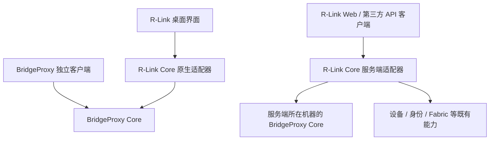

# 独立核心与统一功能体验

R-Link 和 BridgeProxy 按独立核心、完整功能集成、独立产品发版推进。用户可以单独运行 BridgeProxy，也可以在 R-Link 中操作同一个 BridgeProxy Core。

## 职责与独立运行

BridgeProxy 仓库的 `crates/bridgeproxy-core` 是独立 Rust crate，拥有代理配置、运行时、隧道、配对、发现、诊断、控制 API 和生命周期，不依赖 egui/eframe。独立 `bridgeproxy-core` 宿主可运行控制服务；原 BridgeProxy 客户端以默认 desktop feature 保留 GUI/托盘，复用同一 CoreHost。实例锁、配置 revision 和核心命令队列继续约束同一数据目录的单一所有者。

R-Link 仓库的 `crates/r-link-core` 是独立于 Tauri/React 的原生能力适配库。Tauri 只装配它并管理连接授权；FastAPI 的 `core/bridgeproxy.py` 提供服务端组合能力。它们使用同一个版本化路由合同 `contracts/bridgeproxy-v1.json`，不链接或复制代理引擎，也不直接写入 Core 配置。现有设备、身份、Fabric 等服务继续由 R-Link 原有核心模块负责。

## 功能与 API

R-Link 的“网络出口与代理”覆盖服务启停、出口和自定义出站配置、双端验证码配对、链路启停/上游选择/删除、规则及最终动作、TUN/系统代理/应用代理、连接与流量、诊断与日志、节点新版下载、能力清单及操作记录。实际操作按 Core 的平台能力和路由可用性开放；Linux/macOS 当前提供代理、隧道及管理能力，Windows 原生流量接管和 EXE 更新不跨平台冒用，详见[平台范围](cross-platform-core.md)。

BridgeProxy Core 的 API v1 保留现有接口，并增加能力清单、带实例与新鲜度证据的聚合快照、操作列表、自定义出站只写字段和规则/最终动作原子提交。R-Link 服务端 `/api/bridgeproxy/v1` 保留这些业务方法、HTTP 状态、If-Match、幂等键与异步操作语义；另提供适配器元数据及管理员专用的配对验证码视图。完整配置见[接入说明](bridgeproxy-core.md)。

独立 Core 默认不会把自己的 daemon 可执行文件当成桌面版升级包分发。界面依照实际能力清单与版本判断展示可用下载；安装、提权和驱动相关本机确认仍由宿主负责。API 不执行任意命令，也不提供远端静默安装。

## 授权、状态与并发

- 桌面用户明确指定 Core 数据目录并选择是否授予控制。Windows 使用当前账户的 DPAPI；Linux/macOS 使用同用户 0700/0600 私有存储，拒绝链接并保留目录文件描述符。适配器核对宿主 PID/创建时间，只请求该实例的回环 API；令牌不经过 renderer 或持久浏览器存储。
- 本机连接授权保留在 R-Link 进程中，账号切换会撤销；连接 generation 防止已经取消的异步连接重新安装授权。退出 R-Link 只结束管理连接，Core 可以独立继续运行。
- 服务端目标需要管理员配置独立 read/control 凭据；viewer 可读，admin 可控制。服务端回环地址代表服务器本机，不能用于操作浏览器所在电脑。
- 普通读取使用 read scope，验证码仅在明确的 control 视图读取。读取快照与操作列表也不泄露验证码、密码、私钥或自定义出站内容；OpenAPI 字段定义保留。
- 聚合快照提供 instance_id、generation、published_at 与单调时钟计算的 age_ms。界面拒绝过期快照或跨实例混合结果，并单独呈现配置状态、核心运行、认证链路与流量接管。
- 编辑草稿绑定初始化时的配置 revision。后台读取只更新观察状态；提交继续使用草稿原版本，冲突时保留草稿并由用户显式重载。配置只发送实际编辑字段，避免将脱敏显示值回写。
- 配置修改不自动重试。HTTP 202、任务完成和真实网络可用分别核验；轮询超时保留已受理操作的身份，帮助核对结果。

R-SDK 候选读取接口继续默认关闭。此处接入的是 BridgeProxy 自身的成熟业务合同，不启用候选设备发现能力。
